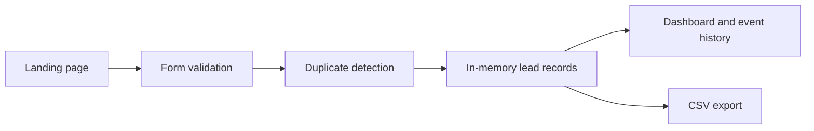

# Essenza Estética — Landing Page & Lead Management

A responsive commercial website and interactive lead-management demonstration by Sara Ingrid. Essenza is a fictional clinic created for a portfolio; it does not provide medical or aesthetic services.

## Features

- V2: user-selected floral symbol recreated as an SVG, favicon, responsive header and editorial illustrations.
- Six service cards in three filterable categories, clinic concept, experience, FAQ, contact section and mobile booking CTA.
- Lead form with sample-data autofill, contact-period preference, validation and duplicate detection.
- Session-only dashboard with search, status filters, four-stage lead funnel, service and source counts, event history and CSV export.
- Resettable synthetic dataset; no third-party runtime dependencies.

- V3: entrance animations, scroll microinteractions with reduced-motion support, conceptual gallery with opt-in external photography, deterministic guided FAQ and explicitly scoped commercial metrics.

- V4: the same landing page runs in a separate authenticated loopback mode with persisted leads, status updates, and a real transactional outbox simulation. The GitHub Pages site is still entirely static.

## Live demo

https://saraingridsousa.github.io/Essenza-aesthetics/

Open `index.html` directly or run `python -m http.server 8000` and visit http://localhost:8000. Select a service, fill the form with example data, submit, and open the dashboard via the demo banner. Use only fictional information; the email must end in example.com/.org/.net. No form information is sent externally. Optional gallery photos are requested from Pexels only on explicit visitor action; the IP is visible to that image host, with referrer suppressed.

## Integrated local demo

Run `python -m backend.api` after setting `ESSENZA_DEMO_TOKEN` as described in [the setup guide](docs/LOCAL-AUTOMATION.md). Open **http://127.0.0.1:8765/**, enter the token in the local banner, submit a sample lead and inspect the persistent dashboard. Use the queue controls to simulate delivery or failure. The token is held only in page memory and must be entered again after reload. No external notification is sent.

## Architecture



## Testing

```bash
python -m pip install playwright
python -m playwright install chromium
python smoke_test.py
```

The smoke test verifies the logo, category filters, lead capture, duplicate prevention, email validation, contact period, search, funnel stages, CSV export, reset, mobile navigation, and layout overflow on six viewport widths (320, 390, 768, 801, 1024, 1440) for both the landing page and dashboard. It loads local HTML with the SVG embedded as a data URI for isolated testing. Set `CHROMIUM_PATH` to use an existing Chromium executable. Screenshots are generated locally and excluded from version control.

## Scope and roadmap

The public static demo has no real scheduling, persistence, authentication, backend integration, CRM integration, notifications or generative AI. The local API serves the same UI in integrated mode; see [local setup and n8n instructions](docs/LOCAL-AUTOMATION.md). Dashboard access is intentionally public for demonstration only. The funnel displays current stage counts, not historical conversion rates. Do not collect actual client information. No invented testimonials, clinical credentials or results. The illustrations are conceptual, not photographs. The noindex directive is intentional for the fictitious brand.

Next: download and optimize authorized photography locally, deploy a protected backend with HTTPS and production authentication, connect a real CRM/n8n instance, and evaluate an evidence-based AI assistant. Actual deployments require approved clinical content, contact information, security and privacy controls.

## Author

Sara Ingrid — software development, data analytics and process automation.
