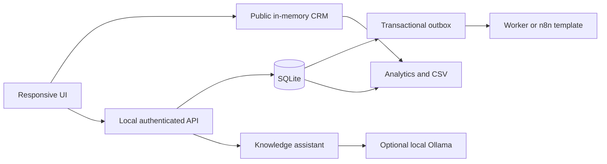

<h1 align="center">Essenza Estética</h1>
<p align="center">Commercial Web Experience · CRM · Analytics · Process Automation</p>
<p align="center"><a href="https://saraingridsousa.github.io/Essenza-aesthetics/">Live demo</a> · <a href="docs/CASE-STUDY.md">Technical case study</a> · <a href="docs/LOCAL-AUTOMATION.md">Local setup</a> · <a href="https://github.com/Saraingridsousa/Essenza-aesthetics/actions">Validation evidence</a></p>
<p align="center"></p>

## Overview

Essenza is a fictional aesthetics clinic designed to demonstrate how a small business can turn a responsive website into a lead-management and analytics workflow. It is a portfolio project, not a real clinic or a production CRM.

| Module | Features |
| --- | --- |
| Commercial website | Custom SVG identity, responsive layout, six filterable services with local WebP photos, photographic gallery, accessible motion and mobile booking CTA |
| Lead capture | Fictional sample data, validation, duplicate prevention, contact period and allowlisted UTM source |
| CRM | Table and drag-and-drop Kanban (desktop and touch handle), status changes, search, CSV export and optional scenario of 90 synthetic leads |
| Analytics | UTC month cohorts, date/channel filters, acquisition breakdown, current converted share by service and report |
| Local backend | Python HTTP API, SQLite, status history, bearer token and transactional outbox with retry/lease fencing |
| Automation | Local worker, aggregate JSON report, importable n8n workflow (simulation only) |
| Assistant | Text retrieval with source sections, abstention on unsupported questions; optional local Ollama composition restricted to approved sentences |

## Try the public demo

1. Open the [website](https://saraingridsousa.github.io/Essenza-aesthetics/), select a service and use the sample-data button.
2. Submit the fictional lead and open the dashboard via the demo banner.
3. Load the 90-lead scenario to explore the Kanban, date/channel filters and commercial report. Reset the demo to return to the three-record sample.
4. Ask the guided assistant an administrative question, e.g. “Como agendar uma avaliação?”. Unsupported questions are escalated instead of answered.

The public demo runs in memory; reload discards changes. No credentials or external API required. Photography throughout the page is a licensed visual reference, not actual clinic imagery; local WebP assets fall back to illustrations if unavailable. Never enter real personal or health data.

## Architecture



The two execution modes are deliberately isolated. Local API data are never sent to the public static demo.

## Run the complete local demo

Python 3.10+; no runtime dependencies.

```bash
# Bash
export ESSENZA_DEMO_TOKEN="$(python -c 'import secrets; print(secrets.token_urlsafe(32))')"
python -m backend.api
```

PowerShell:

```powershell
$env:ESSENZA_DEMO_TOKEN = python -c "import secrets; print(secrets.token_urlsafe(32))"
python -m backend.api
```

Open http://127.0.0.1:8765/ and enter the token from your shell. The integrated site supports persistence, status history and queue simulation.

Alternatively, with Docker installed and the environment token set:

```bash
docker compose up --build
```

Docker maps only host loopback and stores SQLite in a named volume. Native n8n and Ollama setup are documented separately; Docker mode does not include either service.

```bash
python -m backend.worker process
python -m backend.worker report
```

## Quality and evidence

```bash
python -m unittest backend.test_api backend.test_assistant backend.test_worker -v
python -m pip install playwright==1.51.0
python -m playwright install chromium
python smoke_test.py
python -m unittest backend.test_browser -v
```

The validation workflow runs backend regression tests, six-width browser checks, end-to-end local persistence tests and a container health check. The workflow saves screenshots as artifacts on successful browser validation; consult actual [run results](https://github.com/Saraingridsousa/Essenza-aesthetics/actions) rather than treating the existence of a test as proof it passed.

## Scope

- No real clinic, patients, appointment reservation, notifications, payment, authentication for production or hosted backend.
- The n8n workflow is a manual-trigger template; no live n8n delivery has been verified. The local worker demonstrates queue processing without external side effects.
- Public assistance is deterministic text retrieval. Optional Ollama is a constrained composition experiment, not a full RAG system or medical assistant; mock tests do not prove a real model was run.
- Current converted-share metrics are not historical visitor conversion. All commercial records are fictional.
- Approved clinic content, access controls, data protection, deployment and provider integrations are required for production.

See [image credits](docs/IMAGE-CREDITS.md) and [technical case study](docs/CASE-STUDY.md).

## Author

Sara Ingrid — software development, data analytics and process automation.
