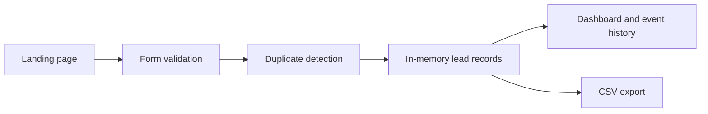

# Essenza Estética — Landing Page & Lead Management

A responsive commercial website and interactive lead-management demonstration by Sara Ingrid. Essenza is a fictional clinic, created for a portfolio project; it does not provide medical or aesthetic services.

## Features

- Responsive landing page, service selection and mobile navigation.
- Lead form with example-data autofill, validation and duplicate detection.
- In-memory dashboard with service counts, status updates, filters, event history and CSV export.
- Resettable synthetic dataset and session-only metrics.
- Original SVG illustrations, no third-party runtime dependencies.

## Demo

Open `index.html` directly or run `python -m http.server 8000` and open http://localhost:8000. The site can be hosted on GitHub Pages from the main branch root.

Select a service, fill the form with the example-data button, submit and open the dashboard via the demo banner. Use only fictional information; the form accepts reserved example.com/.org/.net email addresses. No data is sent to any external service.

## Architecture



## Testing

```bash
python -m pip install playwright
python -m playwright install chromium
python smoke_test.py
```

The browser smoke test checks service selection, lead submission, duplicate prevention, email validation, status changes, filtering, CSV export, reset, mobile navigation and overflow at 320, 390, 768, 1024 and 1440 pixels. Set CHROMIUM_PATH to use an existing Chromium executable. Screenshots are produced locally and excluded from version control.

## Scope and roadmap

The demo has no real scheduling, persistent storage, authentication, backend, CRM integration, notifications or AI. Dashboard access is intentionally public for demonstration only. Do not use it to collect actual client information. No testimonials, clinical credentials or outcomes are invented. The noindex directive is intentional for the fictitious brand.

Next: modular frontend, CI, licensed photography, backend with protected dashboard, server-side validation, database, n8n integration with idempotency and retries, and commercial analytics. A real deployment requires appropriate privacy, security and approved content.

## Author

Sara Ingrid — software development, data analytics and process automation.
