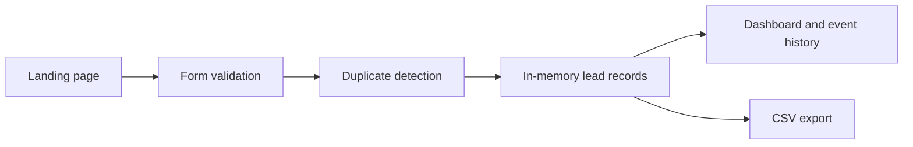

# Essenza Estética — Landing Page & Lead Management

A responsive commercial website and interactive lead-management demonstration by Sara Ingrid. Essenza is a fictional clinic created for a portfolio; it does not provide medical or aesthetic services.

## Features

- V2: user-selected floral symbol recreated as an SVG, favicon, responsive header and editorial illustrations.
- Six service cards in three filterable categories, clinic concept, experience, FAQ, contact section and mobile booking CTA.
- Lead form with sample-data autofill, contact-period preference, validation and duplicate detection.
- Session-only dashboard with search, status filters, four-stage lead funnel, service and source counts, event history and CSV export.
- Resettable synthetic dataset; no third-party runtime dependencies.

## Live demo

https://saraingridsousa.github.io/Essenza-aesthetics/

Open `index.html` directly or run `python -m http.server 8000` and visit http://localhost:8000. Select a service, fill the form with example data, submit, and open the dashboard via the demo banner. Use only fictional information; the email must end in example.com/.org/.net. No information is sent externally.

## Architecture



## Testing

```bash
python -m pip install playwright
python -m playwright install chromium
python smoke_test.py
```

The smoke test verifies the logo, category filters, lead capture, duplicate prevention, email validation, contact period, search, funnel stages, CSV export, reset, mobile navigation, and layout overflow on six viewport widths (320, 390, 768, 801, 1024, 1440) for both the landing page and dashboard. It loads local HTML with the SVG embedded as a data URI for isolated testing. Set `CHROMIUM_PATH` to use an existing Chromium executable. Screenshots are generated locally and excluded from version control.

## Scope and roadmap

No real scheduling, persistence, authentication, backend, CRM integration, notifications or AI. Dashboard access is intentionally public for demonstration only. The funnel displays current stage counts, not historical conversion rates. Do not collect actual client information. No invented testimonials, clinical credentials or results. The illustrations are conceptual, not photographs. The noindex directive is intentional for the fictitious brand.

Next: licensed photography, modular frontend, CI, backend with protected dashboard, server-side validation, database, n8n integration with idempotency and retries, and business analytics. Actual deployments require approved clinical content, contact information, security and privacy controls.

## Author

Sara Ingrid — software development, data analytics and process automation.
