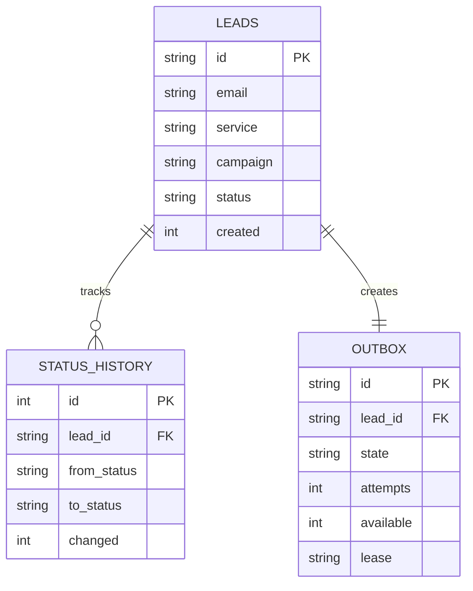

# Essenza — technical case study

## Business problem

A small aesthetics business needs to present services, make contact easy and organize incoming inquiries. A static landing page solves discovery but does not address duplicate leads, sales follow-up, campaign measurement or reliability of integrations.

## Solution and decisions

Two isolated modes: static GitHub Pages for public portfolio visitors, and a loopback Python/SQLite application for technical demonstrations. The latter authenticates data operations with a memory-only bearer token. No customer information is intended for either mode.

The UI uses vanilla HTML/CSS/JS, a custom floral SVG, progressive motion and responsive layouts. A semantic gallery dialog and opt-in stock photography avoid pretending that a fictional clinic has a physical space.

## Data model

The unique key (normalized demo email, service) makes repeated capture idempotent. The lead and outbox event are committed in one transaction. Status changes are recorded transactionally. Lease tokens reject stale acknowledgements; exponential retry delay and a five-attempt limit bound failures. Actual delivery would need receiver deduplication because an event may be processed more than once.

## Analytics methodology

The 90-lead scenario uses a deterministic pattern relative to the current date, not actual business data. Acquisition channel maps only approved UTM sources; raw arbitrary tracking parameters are not stored. Cohorts use UTC received dates. The advanced charts use date/channel filters, while search/status also restrict the Kanban/table. Global cards and CSV represent the full base. Converted share is current converted records divided by records in the selected cohort; no historical visitor denominator is available.

## Assistant

Public text retrieval uses a small reviewed administrative knowledge base, rejects unsupported/ambiguous questions, and links the relevant section. The optional local model receives approved sentences for the matched topic, not raw visitor questions or lead records. Only approved sentence permutations are accepted; failures fall back to the knowledge base. This is a bounded LLM composition experiment, not medical advice or unrestricted generation.

## Demonstration script

1. Show responsive landing page, filters and gallery.
2. Submit sample data and inspect the lead in the CRM.
3. Move the lead through the Kanban, then inspect history and export CSV.
4. Load the synthetic scenario, filter campaign/date and generate a report.
5. In integrated local mode, show persistence across reload, claim/ack and a simulated retry.
6. Run the worker report or explain the n8n import template.
7. Show a grounded FAQ and unsupported-question escalation.

## Results and limitations

The implementation demonstrates a complete synthetic workflow in local mode, not verified ROI or commercial adoption. Test outcomes are recorded in GitHub Actions, including screenshots when browser tests pass. No actual n8n instance or Ollama model is required for the basic demo; integrations with those services must be configured and verified separately. Production deployment, role-based access, privacy and clinical review remain outside this portfolio edition.
